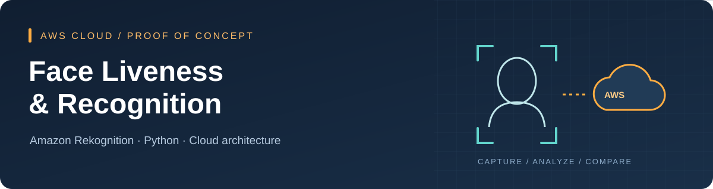
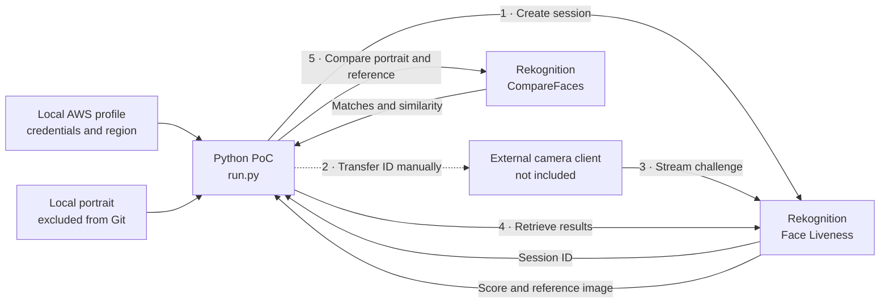

<p align="center">
  
</p>

<p align="center">
  <strong>AWS cloud integration for face-based verification</strong><br>
  Python orchestration · Amazon Rekognition · IAM · Identity workflow design
</p>

<p align="center">
  <a href="#the-use-case">Use case</a> ·
  <a href="#architecture">Architecture</a> ·
  <a href="#getting-started">Getting started</a> ·
  <a href="docs/cloud-design.md">Cloud design</a> ·
  <a href="SECURITY.md">Security</a>
</p>

# Face Liveness & Recognition on AWS

A focused proof of concept exploring how **Amazon Rekognition Face Liveness** and **face comparison** can contribute to identity verification in digital payment journeys. The Python script creates a liveness session, retrieves its results after an external camera client completes the challenge, and compares the returned reference image with a locally supplied portrait.

This repository preserves a small experimental implementation alongside a documented cloud architecture. It is a portfolio snapshot: the script demonstrates service integration, while the architecture notes explain how enrollment, authentication, access control, and operational costs fit into a larger solution.

> **Scope:** the Python orchestration is included. A camera frontend, application backend, face collection, database, and infrastructure deployment are outside this snapshot. A complete liveness check requires a separate capture client.

## The use case

Account takeover is a useful setting for exploring an additional verification signal: can a person complete a live camera challenge, and does the captured face resemble an enrolled portrait? This PoC investigates that integration boundary. It does not process payments or make an authorization decision.

The two scores answer different questions:

| Signal | Question | How this PoC uses it |
| --- | --- | --- |
| Liveness confidence | How confident is the service that the capture represents a live person? | Retrieves and prints the score returned by the liveness service. |
| Face similarity | How similar are the source portrait and captured face? | Calls `CompareFaces` with a similarity threshold of `80`. |

The `80` threshold is an experimental setting, not a calibrated acceptance policy. Liveness and comparison are probabilistic signals. A completed session is not proof of identity, and the script does not enforce a liveness acceptance threshold. See [AWS Face Liveness guidance](https://docs.aws.amazon.com/rekognition/latest/dg/face-liveness.html) and the [CompareFaces API](https://docs.aws.amazon.com/rekognition/latest/APIReference/API_CompareFaces.html).

## Engineering focus

| Area | What the repository demonstrates |
| --- | --- |
| Managed AI integration | Composing liveness session APIs and face comparison through Boto3, without training or hosting a model. |
| Workflow boundaries | Separating camera capture from backend result retrieval and distinguishing enrollment from authentication. |
| AWS access design | Example IAM policies with explicit actions and separate permissions for the script and capture client. |
| Data handling | Image bytes passed directly to the API, excluded local portraits, and removal of full response logging. |
| Cloud architecture | Documented roles for Amplify, API Gateway, Step Functions, Rekognition, Textract, and DynamoDB in a broader design. |
| Operational thinking | Session expiry, failure modes, cost drivers, retention boundaries, and prerequisites for a hosted implementation. |

## Architecture

### Implemented integration



The script requests image bytes directly and does not configure S3 output. It opens the reference image with Pillow and prints scores to the terminal. AWS describes the external capture step in its [Face Liveness integration guide](https://docs.aws.amazon.com/rekognition/latest/dg/face-liveness-programming-api.html).

### Broader cloud design

The accompanying design describes enrollment and repeat verification across web and mobile clients, using an application API to coordinate managed AWS services. It is a **conceptual architecture**, with no deployment or runtime implementation in this repository.

[Explore the cloud design →](docs/cloud-design.md)

## Getting started

**For a local review, no AWS account or portrait is needed:**

```bash
git clone https://github.com/marcofasa/PoC-Face-Rekognition.git
cd PoC-Face-Rekognition
python3 -m venv .venv
source .venv/bin/activate
python -m pip install -r requirements.txt
python -m unittest discover -s tests -v
```

Use **Python 3.11** for the validated baseline. Tests replace the AWS session and client with mocks; they make no AWS calls and use no biometric samples.

**For a live experiment**, follow the [setup and troubleshooting guide](docs/setup.md). You will need an AWS account, appropriate permissions, a supported region, your own local portrait, and a separate Face Liveness capture client. Running `python run.py` alone cannot complete the camera challenge.

## Repository map

```text
.
├── run.py                       # Original orchestration, with raw response logging removed
├── requirements.txt             # Pinned Python dependencies, including transitive packages
├── iam/
│   ├── script-policy.json       # Create session, retrieve results, compare faces
│   └── capture-policy.json      # Start streaming from an external capture client
├── docs/
│   ├── assets/banner.svg        # Original vector artwork, no biometric imagery
│   ├── cloud-design.md          # Enrollment, verification, service choices and costs
│   └── setup.md                 # Live workflow, configuration and troubleshooting
├── tests/test_run.py            # AWS-free orchestration and logging checks
├── .github/workflows/checks.yml # Automated offline checks
└── SECURITY.md                  # Data handling and publication boundaries
```

## Snapshot boundaries

| Included | Outside the snapshot |
| --- | --- |
| Session creation and result retrieval | Camera capture UI and streaming implementation |
| Comparison against a local portrait | Enrollment API, indexed face collection and user database |
| IAM policy examples | Deployed roles, authentication endpoints and infrastructure as code |
| Mocked tests and pinned dependencies | Live integration tests, accuracy benchmarks and load testing |
| Sanitized architecture notes | Company material, original presentations, recordings and biometric samples |

The original interactive script is deliberately small. It reads the `default` AWS profile, constructs its client on import, retrieves results once after an Enter prompt, and assumes a confidence value is available. Missing images, unfinished sessions, service errors, and expired sessions require manual handling. See [known limitations](docs/setup.md#known-limitations).

## Security and operating costs

Credentials belong in local AWS configuration or an approved temporary credential flow. Keep photographs, session identifiers, and image output out of Git and shared logs. The `.gitignore` excludes common sensitive artifacts, but it is not a security boundary. Read [SECURITY.md](SECURITY.md) before experimenting.

Live calls may incur charges. Liveness checks and face comparison have separate usage drivers; the larger architecture also adds orchestration and storage costs. The [cost model](docs/cloud-design.md#cost-model) explains the variables without hardcoding historical prices. Consult [current AWS pricing](https://aws.amazon.com/rekognition/pricing/) before running a live workload.

---

**Frozen snapshot:** [`portfolio-v1.0.1`](https://github.com/marcofasa/PoC-Face-Rekognition/tree/portfolio-v1.0.1) · AWS service integration and cloud architecture exploration
