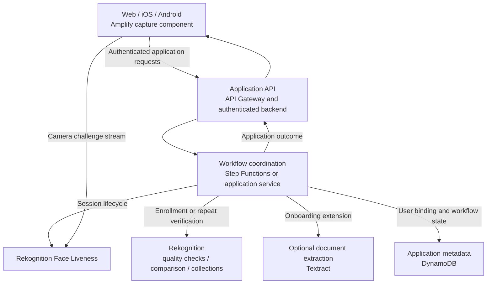

# Cloud architecture and design decisions

This document places the Python experiment in a broader face verification workflow. It consolidates enrollment, authentication, and cost considerations into a generic design. **Only the Python liveness and comparison orchestration is implemented in this repository.** The service diagram below is a design reference, not evidence of a deployment.

## Enrollment and repeat verification

Enrollment establishes the trusted reference against which later captures are compared. A broader application would bind a reference to an authenticated user, apply image quality checks, and decide whether a face collection is needed. The Python experiment substitutes a local `photo.jpg` for that enrollment process.

During repeat verification, an application starts a liveness session for a particular user and retrieves its results after capture completes. A successful processing status, an acceptable liveness score, and an acceptable comparison score are separate conditions. The application's risk policy owns the final decision.



A Spring Boot service using the AWS SDK for Java is one possible application backend. Step Functions is an alternative when the workflow benefits from explicit state transitions and managed orchestration. Neither implementation is shipped here, and both do not have to be deployed together.

## Service responsibilities

| Component | Design responsibility | Relationship to this snapshot |
| --- | --- | --- |
| Amplify capture component | Guide the user through the camera challenge and stream to Rekognition. | Required external integration; frontend omitted. |
| API Gateway and application backend | Authenticate callers, bind sessions to users, expose controlled operations. | Design only; script is a local operator tool. |
| Step Functions | Coordinate an enrollment or verification workflow, timeouts and error paths. | Optional design choice. |
| Rekognition Face Liveness | Analyze the camera challenge and return results. | Session creation and result retrieval implemented. |
| Rekognition CompareFaces | Compare an enrolled portrait with the captured reference. | Implemented with image bytes and threshold `80`. |
| Rekognition collections | Store searchable face representations for identification or enrollment deduplication. | Design only; no collection is created. |
| Textract | Extract document fields for an optional onboarding workflow. | Design only; extraction alone does not validate document authenticity. |
| DynamoDB | Store application user identifiers, reference mappings, and workflow metadata. | Design only; no table or persistence code. |
| S3 | Optional image or audit storage with explicit retention and access controls. | The script does not configure it. |

## Comparison and identification

**One-to-one verification** compares a capture with the reference for a claimed user. This is the operation modeled by `compare_faces()`. The caller supplies the reference; the script does not establish its trustworthiness or bind it to an account.

**One-to-many identification** searches a face collection, for example when checking whether an enrollment resembles an existing record. That is a separate workflow using operations such as `IndexFaces` and `SearchFacesByImage`. It needs its own authorization, retention, and evaluation policy and is outside the implementation.

The script delegates face analysis to Rekognition. It does not implement face cropping, pose normalization, embedding extraction, or a local embedding database.

## Trust boundaries and data flow

The capture client needs narrowly scoped temporary AWS permissions to stream a challenge. An application backend should own session creation, retrieval, and comparison permissions. The [IAM examples](../iam/script-policy.json) keep those action sets separate; the capture client must never receive backend credentials.

In a hosted design, the backend must check that the authenticated caller owns the session and selected reference. Knowing a session ID does not establish ownership. The local Python script assumes a trusted operator and supplies no application authentication.

The camera stream goes to the managed liveness service. In this implementation, the returned reference image reaches the Python process and Pillow's local viewer, and both comparison images are sent to Rekognition. These are sensitive data flows even when an application avoids routing the camera stream through its own backend.

## Cost model

Estimate volume by operation before estimating price. A completed user journey may include a liveness attempt, a comparison, and additional attempts after capture failures. Enrollment and collection searches add separate operations in the broader design.

```text
Monthly service cost =
    tiered cost of liveness attempts
  + tiered cost of face image operations
  + face collection storage, if used
  + application requests and workflow execution
  + database, object storage, logs and data transfer, if used
```

| Driver | Input to estimate |
| --- | --- |
| Liveness attempts | User journeys × average attempts per journey. |
| Comparisons | Completed captures actually submitted for comparison. |
| Enrollment and collection operations | Registrations, deduplication searches, indexing and deletion activity. |
| Stored data | Number of enrolled faces and retained objects, size and retention period. |
| Application infrastructure | API requests, orchestration transitions, backend runtime, database activity and log volume. |

Apply each service's current pricing rules, including volume tiers where relevant. Avoid multiplying all traffic by a single tier's unit price. Retries increase usage, and infrastructure overhead needs an explicit estimate rather than being assumed negligible. Consult [AWS Rekognition pricing](https://aws.amazon.com/rekognition/pricing/) for the selected region and check the prices of any additional services separately.

This snapshot includes no price quote, production traffic assumption, or claimed savings. Tests use mocks and generate no AWS usage; live experiments can incur charges.

## Decisions required before a hosted implementation

| Decision | Reason |
| --- | --- |
| Reference enrollment and account binding | Comparison is meaningful only against a trusted, correctly associated reference. |
| Separate liveness and similarity policies | Each score needs evaluation against the actual use case and error tolerance. |
| Session ownership and replay handling | Application authorization must protect each session and enforce its lifecycle. |
| Retry and timeout behavior | Incomplete, expired, missing-image and failed sessions need explicit outcomes. |
| Data retention and deletion | Portraits, indexed face data, viewer files, logs and backups need defined handling. |
| Alternative verification and review | False rejection and service failure need an appropriate recovery path. |
| Deployment and operations | IaC, role policies, monitoring, cost controls and workload evaluation need implementation and testing. |

No fraud-reduction metric, accuracy benchmark, regulatory compliance result, or production security assessment is claimed by this experiment.
